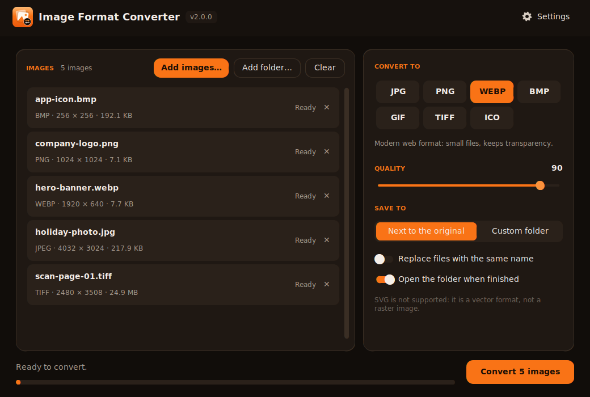

<p align="center">
  
</p>

# PixNexa

**Fast, private image conversion. Everything runs on your own device, nothing is uploaded.**

[](https://github.com/Usef-Farahmand/image-format-converter/actions/workflows/build.yml)
[](https://github.com/Usef-Farahmand/image-format-converter/actions/workflows/ci.yml)
[](https://github.com/Usef-Farahmand/image-format-converter/releases/latest)
[](https://github.com/Usef-Farahmand/image-format-converter/releases)
[](https://github.com/Usef-Farahmand/image-format-converter/blob/main/LICENSE)

**Website and downloads: https://usef-farahmand.github.io/image-format-converter/** · [Report a bug](https://github.com/Usef-Farahmand/image-format-converter/issues/new?template=bug_report.md) · [Request a feature](https://github.com/Usef-Farahmand/image-format-converter/issues/new?template=feature_request.md)

| Edition | Platform | What it does | Download |
| ------- | -------- | ------------ | -------- |
| **PixNexa Desktop** | Windows 10/11 | Offline converter and compressor for images, PDF, video, audio, documents, data, archives, fonts and subtitles; drag and drop, Explorer right-click menu | [`PixNexa_Setup.exe`](https://github.com/Usef-Farahmand/image-format-converter/releases/latest/download/PixNexa_Setup.exe) / [`PixNexa_Portable.zip`](https://github.com/Usef-Farahmand/image-format-converter/releases/latest/download/PixNexa_Portable.zip) |
| **PixNexa Mobile** | Android 7.0+ | Pick, convert (PNG, JPEG, WebP) and share images, fully offline, Persian and English | [`PixNexa.apk`](https://github.com/Usef-Farahmand/image-format-converter/releases/latest/download/PixNexa.apk) |
| **PixNexa Web** | Any modern browser | Batch PNG/JPEG/WebP conversion inside the browser (nothing is uploaded), quality slider, before/after sizes, ZIP download | [Open it](https://usef-farahmand.github.io/image-format-converter/#convert) |

This README covers **PixNexa Desktop**. PixNexa Mobile lives in [`android/`](android/README.md). One workflow builds all apps, and every push to `main` publishes **one release with every file** (Windows installer and portable zip, Android APK and AAB, SHA256SUMS.txt). The website is in [`site/`](site/) and is deployed by [`pages.yml`](.github/workflows/pages.yml).



*Screenshot uses demo data.*

---

## Table of contents

- [Features](#features)
- [Supported formats](#supported-formats)
- [Download and install (Windows)](#download-and-install-windows)
- [How to use it](#how-to-use-it)
- [Run from source](#run-from-source)
- [How the GitHub Action builds it](#how-the-github-action-builds-it)
- [Build it yourself](#build-it-yourself)
- [Project structure](#project-structure)
- [Limitations](#limitations)
- [Troubleshooting](#troubleshooting)
- [Contributing](#contributing) · [Security](#security) · [Privacy](#privacy) · [License](#license)

## Features

- **One app for every kind of file**: images, PDF, video, audio, Word / Excel / PowerPoint and OpenDocument files,
  Markdown and HTML, JSON / YAML / TOML / XML / CSV, archives, fonts and subtitles (see the
  [format table](#supported-formats)).
- **Convert or Compress**: a switch at the top of the right panel. *Convert* changes the format; *Compress* makes
  pictures, PDFs, videos and sound files smaller and shows **before → after size and the saving in %** for every file.
- **Mixed lists**: add any files at once (**Add files…**, **Add folder…**, drag and drop, or Explorer's right-click
  menu). The right panel shows one block per kind of file in the list, each with only the targets and options that
  fit (for example *Images → WEBP* and *Video → MP4* in one run).
- **Combine files**: *pictures → one PDF* (picture size, A4 or Letter pages), *merge PDFs*, and *pack all files into
  one ZIP / 7Z / TAR.GZ*.
- **Images**: JPG, PNG, WEBP, AVIF, HEIC, BMP, GIF, TIFF, ICO, TGA and PDF output; HEIC / HEIF, AVIF, PSD, JPEG 2000,
  QOI, DDS and everything else Pillow reads as input. Quality slider, resize (fit inside a box or a percentage),
  grayscale, and **Remove metadata** (EXIF, GPS, camera; on by default).
- **Image compression**: quality, longest side, an optional **target size in KB** (the best quality that fits is
  found by binary search, the picture is scaled down only if needed), PNG reduced to 256 colours, and keep the format
  or save as JPG / WEBP / AVIF. A file is never made bigger than the original.
- **PDF**: pages → PNG / JPG at a chosen DPI, PDF → TXT, split into one PDF per page, keep a page range
  (`1-3, 5`), merge, and **compress** (pictures recompressed as JPEG and scaled down to 72 / 150 / 300 dpi where
  they are drawn, metadata and thumbnails removed, object streams). Text and drawings stay sharp.
- **Video** (FFmpeg, included): MP4 (H.264 + AAC), WEBM (VP9 + Opus), MKV, MOV, AVI, animated GIF, or just the
  sound as MP3 / M4A / WAV / FLAC / OGG / OPUS. Quality presets, 1080p / 720p / 480p, H.264 or H.265.
  **Video compression** with CRF presets. Real per-file progress from FFmpeg.
- **Audio**: MP3, M4A, WAV, FLAC, OGG, OPUS with a bitrate; **audio compression** by bitrate.
- **Documents** (with [LibreOffice](https://www.libreoffice.org/), if installed): DOCX, DOC, ODT, RTF, TXT, HTML ⇄ PDF
  and each other; XLSX, XLS, ODS → PDF, CSV, HTML and each other; PPTX, PPT, ODP → PDF and each other. Without
  LibreOffice: Markdown → HTML, HTML / DOCX → TXT, XLSX → CSV / JSON.
- **Data, archives, fonts, subtitles** are built in: JSON ⇄ YAML ⇄ TOML ⇄ XML, CSV / JSON / XLSX tables; extract ZIP,
  7Z, TAR, TAR.GZ / BZ2 / XZ (safely) or repack them; TTF / OTF ⇄ WOFF / WOFF2; SRT ⇄ ASS / SSA ⇄ WebVTT ⇄ MicroDVD
  ⇄ TTML.
- **Live progress**: every row has its own progress bar and result (✓ new name and sizes / ✗ reason), plus an
  overall bar; **Stop** cancels the current file, including a running FFmpeg.
- Everything that worked before still does: real multi-size **ICO** files, **animated GIF ⇄ WEBP**, **camera
  rotation** (EXIF orientation) applied, transparency kept or painted on white, an existing file is **never
  overwritten** (`photo (1).png`) unless you switch that on, and the original is never touched.
- **Right-click menu in Explorer**: right-click any supported file → **Convert with PixNexa**; several selected files
  land in the same window.
- Works with **Persian and other non-English file names**, and Ctrl+C / Ctrl+V work with any keyboard layout.
- **Private and offline**: no network access, no telemetry; FFmpeg and LibreOffice run on your computer.
- Modern dark-and-orange interface, built with [CustomTkinter](https://github.com/TomSchimansky/CustomTkinter).

## Supported formats

| Kind | Input | Convert to | Compress |
| ---- | ----- | ---------- | -------- |
| **Images** | JPG, PNG, WEBP, AVIF, HEIC / HEIF, BMP, GIF, TIFF, ICO, TGA, PSD, JPEG 2000, QOI, DDS, ICNS, PCX, PPM / PGM / PBM, … | JPG, PNG, WEBP, AVIF, HEIC¹, BMP, GIF, TIFF, ICO, TGA, PDF; several pictures → one PDF | quality, longest side, target size in KB, PNG 256 colours; same format or JPG / WEBP / AVIF |
| **PDF** | PDF | PNG or JPG per page (DPI), TXT, one PDF per page, page range; merge several | pictures recompressed and scaled to 72 / 150 / 300 dpi, metadata removed |
| **Video**¹ | MP4, MOV, MKV, WEBM, AVI, WMV, FLV, MPG, TS / MTS / M2TS, 3GP, OGV, VOB, MXF, … | MP4, WEBM, MKV, MOV, AVI, GIF; sound only: MP3, M4A, WAV, FLAC, OGG, OPUS | MP4 with H.264 or H.265 at a CRF preset, optional 1080p / 720p / 480p |
| **Audio**¹ | MP3, M4A, AAC, WAV, FLAC, OGG, OPUS, WMA, AIFF, AMR, APE, WV, … | MP3, M4A, WAV, FLAC, OGG, OPUS | bitrate (lossless files become MP3) |
| **Documents** | DOCX, DOC, ODT, RTF, TXT, WPD, Pages, Markdown, HTML | PDF², DOCX², ODT², RTF², DOC², TXT, HTML | – |
| **Spreadsheets** | XLSX, XLSM, XLS, ODS, Numbers | PDF², XLSX², ODS², XLS², HTML², CSV, JSON | – |
| **Presentations** | PPTX, PPT, PPS(X), ODP, Keynote | PDF², PPTX², ODP², PPT² | – |
| **Data** | JSON, JSON Lines, YAML, TOML, XML, CSV, TSV | JSON, YAML, TOML, XML, CSV, XLSX (CSV / XLSX for table-like data) | – |
| **Archives** | ZIP, 7Z, TAR, TAR.GZ / TGZ, TAR.BZ2, TAR.XZ, GZ, BZ2, XZ | extract to a folder, ZIP, 7Z, TAR.GZ; any files → one ZIP / 7Z / TAR.GZ | – |
| **Fonts** | TTF, OTF, WOFF, WOFF2 | TTF / OTF, WOFF, WOFF2 | – |
| **Subtitles** | SRT, ASS, SSA, VTT, MicroDVD SUB, SAMI (SMI), TTML | SRT, ASS, SSA, VTT, SUB, TTML | – |

¹ Uses **FFmpeg**, which is included in the installer and the portable zip (`ffmpeg\ffmpeg.exe` next to
`PixNexa.exe`). HEIC is written with FFmpeg's HEVC encoder; HEIC is read without it.
² Needs **[LibreOffice](https://www.libreoffice.org/download/download-libreoffice/)** (free). PixNexa finds it in the
usual install folders or on `PATH` and shows a *Get LibreOffice* button when it is missing. TXT, HTML, CSV and JSON
from DOCX / HTML / Markdown / XLSX work without it.

**Not supported:** SVG and other vector formats (raster → SVG needs tracing; use [Inkscape](https://inkscape.org/)),
camera RAW files, password-protected PDFs and archives, RAR, e-books, CAD and 3D files.

## Download and install (Windows)

> Earlier versions were called *Image Format Converter*. Installing PixNexa Desktop over them upgrades in place: your options and the right-click menu are carried over.

1. Open the [**Releases**](https://github.com/Usef-Farahmand/image-format-converter/releases/latest) page.
2. Download one of:
   - `PixNexa_Setup.exe`: installer (Start menu + desktop shortcut, no admin rights needed)
   - `PixNexa_Portable.zip`: no installation; unzip and run `PixNexa.exe`
3. Run it.

> **Windows SmartScreen warning?** The app is not code-signed yet. Click **More info → Run anyway**. Every release ships with `SHA256SUMS.txt` so you can verify your download; see [CODE_SIGNING.md](CODE_SIGNING.md).
> You can always review the source code and build the app yourself (see below).

## How to use it

1. Add files: click **Add files…** (or press `Ctrl+O`), **Add folder…**, drag files and folders onto the window, or
   right-click a file in Explorer (see below). Each file shows a thumbnail (pictures and PDFs) or a coloured type
   badge.
2. Pick **Convert** or **Compress** at the top of the right panel.
3. For every kind of file in the list, choose a target and its options (quality, size, DPI, pages, video quality,
   bitrate ...). In Compress mode, files that cannot be compressed (documents, archives ...) are skipped.
4. Choose where to save: **Next to the original** (default) or a **Custom folder**.
5. Press **Convert** / **Compress**. Each row shows ✓ with the new file name and the sizes, or ✗ with the reason.
   **Stop** cancels the running file.
6. To combine files, use the buttons under **Combine files**: *pictures → one PDF*, *merge PDFs*, or *pack the
   files into one ZIP / 7Z / TAR.GZ*. The result is named after the first file.
7. The folder opens when it is finished (can be turned off).

Results never replace the original: `photo.jpg` compressed becomes `photo-compressed.jpg`, a PDF's pages go into a
new folder `report/` (`report-001.png`, ...), and an archive is extracted into a folder named after it.

Your options are remembered. **Settings → Reset options** brings the defaults back. **Settings → Helper programs**
shows whether FFmpeg and LibreOffice were found.

### Right-click menu in Windows Explorer

Right-click a supported file → **Convert with PixNexa**. The app opens (or comes to the front if it is already open)
with the file added; you pick the target and press Convert there.

- The installer offers this as an option (on by default) and removes it again when you uninstall.
- With the portable version, or when running from source, turn it on in **Settings → Windows Explorer**. It is stored
  for your user only: no administrator rights are needed.
- On **Windows 11** the item is in the classic menu: right-click → **Show more options**.
- Select several files and right-click: they all open in one window (Windows itself may ask for confirmation when
  you select a large number of files).
- If the item ever points to an old location (you moved the app), or an update added new file types, the app
  repairs it the next time it starts.

## Run from source

Requirements: **Python 3.10+** on Windows (Linux and macOS also work, but only Windows is supported and tested in
releases). For video, audio and HEIC output install [FFmpeg](https://ffmpeg.org/download.html) and put it on `PATH`
(or set `PIXNEXA_FFMPEG` to the full path of `ffmpeg.exe`); for Office files install LibreOffice (or set
`PIXNEXA_SOFFICE`).

```
git clone https://github.com/Usef-Farahmand/image-format-converter.git
cd image-format-converter
pip install -r requirements.txt
python image_converter_gui.py
```

On Windows you can also double-click `run_gui.bat`: it creates a virtual environment and installs everything on the
first run.

Use the converters from your own Python code:

```python
from converter_core import convert_image

convert_image("photo.jpg", "png")                            # -> photo.png next to the original
convert_image("logo.png", "ico", out_dir="icons")            # multi-size icon in another folder
convert_image("photo.png", "webp", quality=80, overwrite=True)
convert_image("big.jpg", "jpg", target_kb=300, suffix="-small")   # at most ~300 KB

from pixnexa_engines import Options, registry

registry.convert_file("clip.mov", "mp4", Options(max_height_px=720)).outputs
registry.compress_file("scan.pdf", Options(dpi=150, quality=65)).outputs
registry.convert_file("report.pdf", "png", Options(dpi=200, pages="1-3")).outputs
registry.images_to_pdf(["a.jpg", "b.png"], Options(page_size="a4"))
registry.pack_files(["a.txt", "photos"], "zip")
```

Run the tests (the FFmpeg and LibreOffice tests skip themselves when those programs are not installed):

```
pip install -r requirements-dev.txt
python -m pytest
```

## How the GitHub Action builds it

[`.github/workflows/build.yml`](.github/workflows/build.yml) builds **all PixNexa apps in one run**, with one version number:

- **Windows** job: downloads a pinned, checksum-verified FFmpeg build ([`tools/fetch_ffmpeg.ps1`](tools/fetch_ffmpeg.ps1)), tests, PyInstaller, `PixNexa.exe --self-test` (one tiny conversion per engine with the bundled FFmpeg), Inno Setup installer, portable zip
- **Android** job: signed APK and App Bundle (Gradle), see [android/README.md](android/README.md) for the signing secrets
- **Publish** job: collects every file, writes `SHA256SUMS.txt` and creates the release

| Trigger | Result |
| ------- | ------ |
| Pull request, push to any other branch | Build + tests. All files are kept as **Artifacts** of the run for 14 days (Actions → the run → Artifacts). No tag, no release. |
| Push to `develop` | Same, plus a git tag `vMAJOR.MINOR.0-dev.<build number>`. No release. |
| Push to `main` | Same, plus a git tag and **one public GitHub Release** `vMAJOR.MINOR.<build number>` containing `PixNexa_Setup.exe`, `PixNexa_Portable.zip`, `PixNexa.apk`, `PixNexa-<version>.apk`, `PixNexa-<version>.aab` and `SHA256SUMS.txt`. |
| Push of a tag `vX.Y.Z` | A release named exactly after the tag. |
| *Run workflow* button | Same as a push to the selected branch. |

The newest files always have stable links: `https://github.com/Usef-Farahmand/image-format-converter/releases/latest/download/<file name>`.


Pushes that only change docs (`*.md`, `docs/`, issue templates ...) do not start a build. To start a new release line, change the number in the [`VERSION`](VERSION) file (for example `2.2.0`). The same version string is shown in the desktop app, the exe properties, the installer, the Android app (`versionName`) and the release name.

[`ci.yml`](.github/workflows/ci.yml) additionally lints with Ruff and runs the tests on Windows and Linux.

## Build it yourself

On Windows, double-click `build_exe.bat`. It creates `dist\PixNexa\PixNexa.exe`, downloads FFmpeg into
`dist\PixNexa\ffmpeg\` (with [`tools/fetch_ffmpeg.ps1`](tools/fetch_ffmpeg.ps1), checksum-verified), runs the
self-test, and if [Inno Setup](https://jrsoftware.org/isinfo.php) is installed also builds `Output\PixNexa_Setup.exe`.

## Project structure

```
image-format-converter/
├── image_converter_gui.py   # desktop app: window, file list, Convert / Compress panel, settings (customtkinter)
├── converter_core.py        # image engine (Pillow + pi-heif), the public convert_image() API
├── pixnexa_engines/         # every other engine, no GUI code
│   ├── registry.py          # kinds of files, their targets, convert_file() / compress_file() / combine helpers
│   ├── base.py              # Options, safe output names, temporary files, running external programs
│   ├── pdf.py               # pages → pictures / text, merge, split, ranges, compression, pictures → PDF
│   ├── media.py             # video and audio with FFmpeg (progress, Stop)
│   ├── heif.py              # HEIC writer (HEVC from FFmpeg in a HEIF container)
│   ├── office.py            # LibreOffice, Markdown → HTML, HTML / DOCX → TXT, XLSX → CSV / JSON
│   ├── data.py              # JSON, YAML, TOML, XML, CSV, XLSX
│   ├── archives.py          # ZIP, 7Z, TAR (+ GZ / BZ2 / XZ): safe extract, pack, repack
│   ├── fonts.py             # TTF / OTF ⇄ WOFF / WOFF2
│   └── subtitles.py         # SRT, ASS, SSA, VTT, MicroDVD, SAMI, TTML
├── self_test.py             # PixNexa.exe --self-test, used by the build
├── shell_integration.py     # Explorer right-click menu entry (per-user registry keys)
├── single_instance.py       # one window only; later launches hand their files to it
├── app_common.py            # app name, version, author, links
├── VERSION                  # the version number (single source of truth)
├── tools/
│   ├── set_version.py       # decides the build version and injects it everywhere
│   ├── fetch_ffmpeg.ps1     # downloads the pinned FFmpeg build for the Windows package
│   └── make_icons.py        # draws the logo, icon and social-preview image
├── tests/                   # pytest: every engine, registry, Explorer menu, version tool, window smoke test
├── assets/                  # logo and icons
├── docs/                    # README images
├── installer.iss            # Inno Setup installer script
├── run_gui.bat              # run from source on Windows
├── build_exe.bat            # build the exe locally on Windows
├── requirements.txt         # runtime dependencies
├── requirements-dev.txt     # + pytest and ruff
├── THIRD-PARTY-NOTICES.md   # bundled components and their licenses (FFmpeg included)
├── CODE_SIGNING.md          # code-signing policy and SmartScreen guide
└── .github/                 # workflows, issue and PR templates, Dependabot
```

## Limitations

- **SVG**, camera **RAW**, RAR, e-books, CAD and 3D files are not supported.
- **Office documents need LibreOffice.** Without it, only Markdown → HTML / TXT, HTML / DOCX → TXT and XLSX → CSV /
  JSON work. LibreOffice's layout can differ slightly from Microsoft Office's.
- **Password-protected** PDFs and archives are refused.
- **HEIC output** is a single picture (no transparency, depth or burst), 8-bit 4:2:0; transparency is painted on
  white. HEIC files are read with their first (main) picture.
- **Animation** is kept only for GIF ⇄ WEBP (and video → GIF). Converting an animated image to any other format uses
  its first frame.
- **Metadata**: EXIF (camera, GPS, date) is removed unless you turn *Remove metadata* off; colour profiles are kept.
- **PDF compression** recompresses 8-bit RGB / gray pictures; CMYK, indexed, JPEG 2000, JBIG2 and fax pictures, fonts
  and vector drawings stay as they are. A PDF without pictures hardly gets smaller.
- **PDF → TXT** needs a text layer; scanned pages have none (there is no OCR).
- **Data → CSV / XLSX** needs table-like data (a list of records); nested values are flattened (`address.city`).
- **Subtitles**: positions, fonts and karaoke timing are not kept; SAMI is read only. MicroDVD is written at
  23.976 fps.
- Converting to **JPG / WEBP / AVIF / HEIC** and compressing are lossy; **GIF** has 256 colours.
- Folders are added without their sub-folders (but *Pack into one archive* includes whole folders).
- The Explorer right-click item is for files, not folders, and it is not shown in Windows 11's new compact menu
  (only under **Show more options**).
- No code signing yet, so Windows SmartScreen may warn on first launch.

## Troubleshooting

| Problem | Fix |
| ------- | --- |
| "Windows protected your PC" | Click **More info → Run anyway**. See [CODE_SIGNING.md](CODE_SIGNING.md). |
| A file is "skipped (not supported)" when added | Its type is not in the [format table](#supported-formats). Pictures with an unusual extension are still detected by their content. |
| "FFmpeg was not found" | The `ffmpeg` folder next to `PixNexa.exe` is missing (an antivirus may have removed it). Reinstall, unzip the portable version again, or put any `ffmpeg.exe` there. |
| "This conversion needs LibreOffice" | Install [LibreOffice](https://www.libreoffice.org/download/download-libreoffice/) (free), then try again; **Settings → Helper programs** shows whether it was found. |
| A LibreOffice conversion is slow the first time | LibreOffice prepares its settings folder on first use (a few seconds); later conversions are faster. |
| A row says ✗ "password-protected" | Remove the password (open the PDF and save an unprotected copy, or extract the archive with its own tool). |
| "This PDF has no text layer" | The PDF contains scanned pictures; convert it to PNG instead. |
| "already as small as it gets" after compressing | The result would not have been smaller, so the original was kept. Choose a lower quality, a smaller size or a lower resolution. |
| "The archive is unsafe" | The archive tries to write outside its folder; nothing was extracted. |
| Drag and drop does nothing | Use **Add files…** instead. Dropping onto an app that runs as administrator is blocked by Windows. |
| The right-click item is missing | Turn it on in **Settings → Windows Explorer**. On Windows 11 look under **Show more options**. |
| Ctrl+V does not paste into the folder field | Right-click the field → Paste. |
| Output is next to the original but the file has `(1)` in its name | A file with that name already existed. Turn on **Replace files with the same name** to overwrite it. |

## Contributing

Contributions are very welcome! Please read [CONTRIBUTING.md](CONTRIBUTING.md) and follow the [Code of Conduct](CODE_OF_CONDUCT.md).

## Security

Found a vulnerability? Please do **not** open a public issue; see [SECURITY.md](SECURITY.md).

## Privacy

Everything happens on your computer; see [PRIVACY.md](PRIVACY.md).

## History

Versions 1.x were a small `.cmd` + PowerShell script. They are still available in the tags [`v1.0.0`](https://github.com/Usef-Farahmand/image-format-converter/releases/tag/v1.0.0) and [`v1.1.0`](https://github.com/Usef-Farahmand/image-format-converter/releases/tag/v1.1.0). Version 2 is a full desktop app. See [CHANGELOG.md](CHANGELOG.md).

## License

Released under the [MIT License](LICENSE) © 2026 [Usef Farahmand](https://github.com/Usef-Farahmand) · [useffarahmand.com](https://www.useffarahmand.com/).

## Acknowledgments

[Pillow](https://python-pillow.org/) · [pi-heif](https://github.com/bigcat88/pillow_heif) · [pypdfium2](https://github.com/pypdfium2-team/pypdfium2) · [pikepdf](https://github.com/pikepdf/pikepdf) · [FFmpeg](https://ffmpeg.org/) · [py7zr](https://github.com/miurahr/py7zr) · [fontTools](https://github.com/fonttools/fonttools) · [pysubs2](https://github.com/tkarabela/pysubs2) · [openpyxl](https://openpyxl.readthedocs.io/) · [CustomTkinter](https://github.com/TomSchimansky/CustomTkinter) · [tkinterdnd2](https://github.com/Eliav2/tkinterdnd2) · [PyInstaller](https://pyinstaller.org/) · [Inno Setup](https://jrsoftware.org/isinfo.php). The format matrix and the Convert / Compress ideas were inspired by [Filee](https://github.com/KnifeLemon/Filee) (MIT). Full license list: [THIRD-PARTY-NOTICES.md](THIRD-PARTY-NOTICES.md). The build pipeline and the dark-and-orange theme follow [SnapshotAll](https://github.com/Usef-Farahmand/SnapshotAll).
